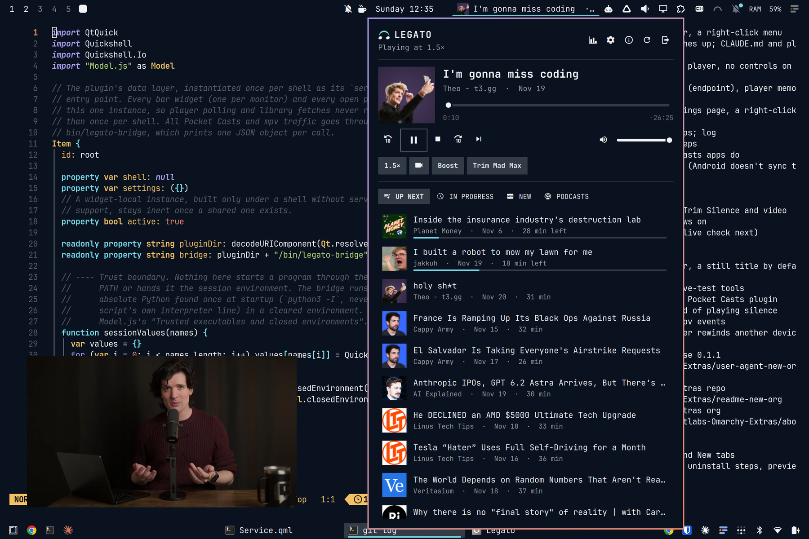
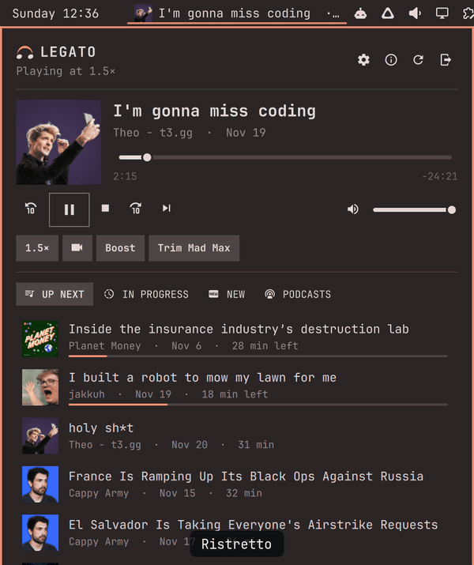
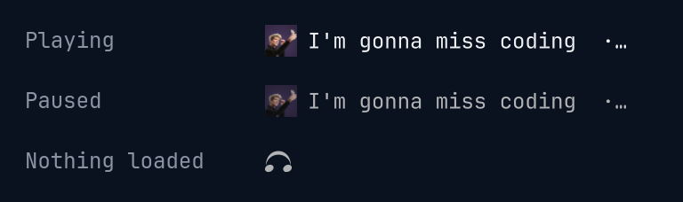
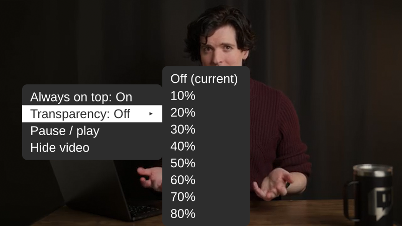
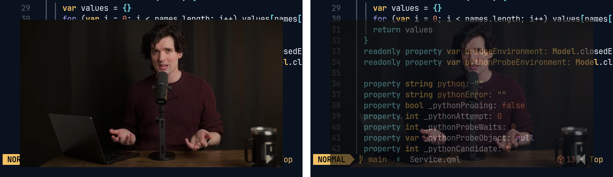
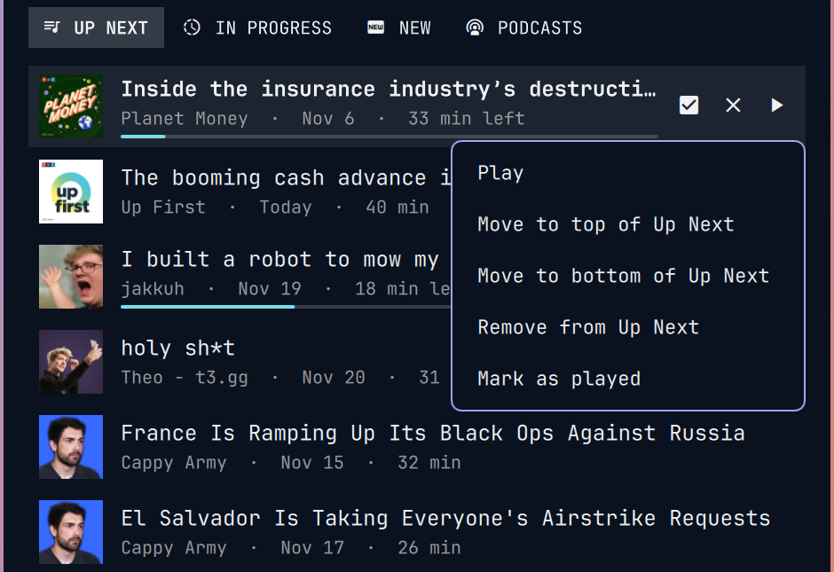
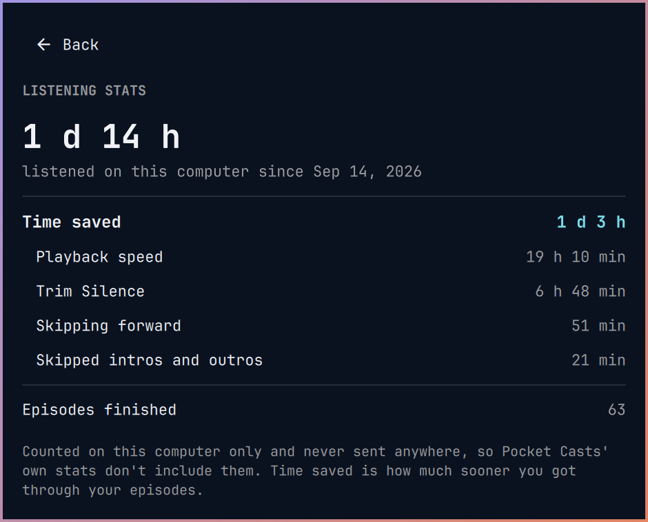
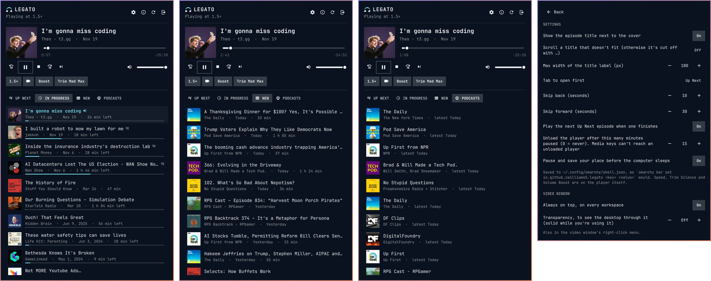

<h1 align="center">
  <picture>
    <source media="(prefers-color-scheme: dark)" srcset="branding/legato/lockup-dark.svg">
    
  </picture>
</h1>

**A Pocket Casts player for the [Omarchy](https://omarchy.org) bar that keeps
your place across your phone and your computers:** Up Next, In Progress, new
episodes and your shows, with speed, Trim Silence, Volume Boost and a small
video window.



Pause an episode here, carry on listening on your phone, come back: before
Legato plays again it asks Pocket Casts where you got to, and picks up from
there. It doesn't send an old position over a newer one, so your phone
isn't rewound. Audio plays through `mpv` in the background, with no browser
and no app window. *Legato* is the musical instruction to play notes
smoothly, with no break between them.

Based on [omarchy-pocketcasts](https://github.com/Ninepointlabs-Omarchy-Extras/omarchy-pocketcasts)
by Nine Point Labs (MIT). What's new compared to the original:

- **Resuming never rewinds another device.** The original sent its own,
  older position when you pressed play, rewinding the phone.
- **Nothing runs while paused or idle.** The original started a Python
  process every 5 seconds while playing and every minute while idle.
- **A failed load says so,** instead of showing an episode playing in
  silence, and **a dropped stream isn't finished:** the original marked
  the episode played wherever the audio stopped.
- **New:** Trim Silence, Volume Boost, a picture-in-picture video window,
  each show's skip intro and outro, pausing before the computer sleeps,
  listening stats (on this computer only), a Settings page whose choices
  stay when the plugin is turned off, right-click menus, and its own icon
  in the bar.

> **Unofficial.** Pocket Casts has no public API for your account. Legato
> uses the same endpoints as the Pocket Casts web player, so a change on
> their side can break it. It isn't affiliated with or endorsed by Pocket
> Casts or Automattic.

<p align="center">
  
</p>

## What you get

- **One place across all your devices.** Every resume asks Pocket Casts
  first: later in the same episode, a different episode another device
  moved on to, or nothing left if it finished everything. Your position goes
  to Pocket Casts every 30 seconds while playing and when you pause, so your
  phone carries on from the right spot.
- **Your queue, in the bar.** The chip shows the cover and title of what's
  playing. Click it for the panel: the player, then tabs for Up Next, In
  Progress, New releases and your shows.

  

- **Listen the way the Pocket Casts apps do.** Speed from 0.8× to 3× that
  keeps voices at their pitch; Trim Silence at the apps' own levels (Mild,
  Medium, Mad Max), which shortens the pauses between words before the
  speed-up applies; Volume Boost (+10 dB into a limiter, so it never clips);
  and each show's "skip first" and "skip last" times from your Pocket Casts
  settings.
- **Video in a small window.** For an episode with video, show it in a
  floating window that sits on every workspace without taking focus. Move
  or resize it and it opens there next time. Right-click it for Always on
  top and Transparency, which lets your desktop show through while you work
  in other windows (it turns solid while you use it). Legato's keys work in
  the window; mpv's own are off there. While it's on top, it's tagged
  `skip-taskbar`, a tag a taskbar or window switcher can honor to leave
  it out (none in Omarchy itself does yet).

  

  

- **Right-click an episode** to play it, move it to the top or bottom of Up
  Next (or play it next or last), remove it, or mark it played.

  

- **Pauses before your computer sleeps.** Close the lid and Legato pauses
  the episode and saves your place in Pocket Casts first, so nothing plays
  on behind the lock screen and your phone knows where you are.
- **Listening stats,** for fun: how long you've listened on this computer,
  and how much time speed, Trim Silence, skipping forward and the shows'
  intro and outro skips saved you (the chart button in the panel's header,
  or `a`). Counted on this computer only and never sent anywhere; the
  Stats page turns counting off and clears what's there.

  

- **Keyboard-friendly,** in the panel's lists and player and in the video
  window (see [Keys](#keys)), and scriptable through `omarchy-shell` for
  your own keybindings. (The Settings, Stats and About pages' buttons take
  the mouse.)
- **Follows your Omarchy theme,** light or dark.



## Install

```bash
omarchy plugin add https://github.com/cwilliams5/omarchy-legato --enable
```

The chip appears in the right section of the bar. Click it and sign in with
your Pocket Casts email and password.

**Dependencies:** none beyond Omarchy. It plays through `mpv` (with
`mpv-mpris` for media keys), runs its helper on Python 3, and uses the
stock `systemd-inhibit`, `setpriv` and `dbus-monitor` (to pause before
sleep), `notify-send` (messages while the panel is closed) and `hyprctl`
(for the video window): all part of Omarchy. You need
a Pocket Casts **email and password;** if you sign in to Pocket Casts with
Apple or Google, set a password on your account first. Only for
development: Node.js and, optionally, `qmllint` (Qt 6) for the tests.

**What it changes:** only its own files:

- `~/.local/state/omarchy-legato/`: your sign-in tokens, the episode loaded,
  your settings and your listening stats (each file readable only by you)
- `~/.cache/omarchy-legato/`: cover art
- its own entry in `~/.config/omarchy/shell.json` (where the chip sits;
  Omarchy writes it)
- while it runs: mpv's socket in `$XDG_RUNTIME_DIR/omarchy-legato/`, and
  once per mpv or FFmpeg update a few seconds' test folder,
  `/tmp/legato-check-*`, removed when the check ends

While the video window is shown, Legato adds its window rules to the
running Hyprland through `hyprctl` (where the window goes, no title bar, its
transparency, and the `skip-taskbar` tag while it's on top). They live in memory only and are gone at the next config
reload; your Hyprland and Omarchy config files are never edited. While an
episode is loaded, Legato holds a short logind sleep delay, released as soon
as it has saved your place.

## Uninstall

```bash
~/.config/omarchy/plugins/io.github.cwilliams5.legato/bin/legato-bridge stop   # mpv runs on its own: stop it first
omarchy plugin remove io.github.cwilliams5.legato
rm -rf ~/.local/state/omarchy-legato ~/.cache/omarchy-legato   # sign-in tokens, playback state, stats, cover art
```

If you showed a video, the window rules Legato added to the running
Hyprland stay until it reloads its config: `hyprctl reload`, or log out.

## Resources

- **Paused or idle, no process starts.** Pause, resume, seeks and the end
  of an episode all arrive as events from mpv. Paused, one timer waits for
  the idle unload (15 minutes by default) and starts one process when it
  fires.
- **While playing,** one short Python process every 30 seconds sends your
  position to Pocket Casts (about 0.1 to 0.2 s of CPU each, depending on
  the machine); with the Stats page open, one more after each, to keep its
  numbers current.
- **While an episode is loaded,** helpers wait with no timer (about 75 MB
  of memory between them, two of them Python): the sleep guard (for the pause before sleep, with
  `dbus-monitor` and `systemd-inhibit`) and the feed proxy mpv fetches
  through. They end with the player. The proxy's connection to the show's
  server is checked by the kernel every 20 seconds while idle (TCP
  keepalive), so a dead link is noticed.
- **mpv** uses about 90 MB with an episode loaded and no CPU while paused,
  plus about 100 MB once its video window has been shown, until the player
  closes. After 15 minutes paused (`unloadAfterMinutes`), the player closes
  altogether; play picks up from wherever Pocket Casts says you are.

**Tested with** Omarchy 4.5.0, Quickshell 0.3.2, Qt 6.12.0, Hyprland 0.56.2,
mpv 0.41.0 with mpv-mpris 1.3 and Python 3.14, on a laptop with Intel Iris
Xe graphics (with a second, NVIDIA GPU that Legato keeps the video window
off), with the Pocket Casts Android app and web player as the other
devices.

## Known limits

- **It can break** when Pocket Casts changes the web player's endpoints (see
  *Unofficial* above).
- **Speed, Trim Silence and Volume Boost are Legato's own,** the same for
  every show, and not synced with your phone's: the Pocket Casts Android app
  doesn't upload its playback effects. A show's skip intro and outro do
  sync.
- **Streaming only:** no downloads for offline listening.
- **No drag to reorder Up Next:** use the right-click menu's top and bottom.
- **An unloaded player can't hear media keys.** After `unloadAfterMinutes`
  paused, start it from the bar or the panel, or set it to `0`.
- **Trim Silence with video:** the picture falls behind at each trimmed
  pause, as in the Pocket Casts Android app.
- **Episodes on your local network** (a home media server, a Tailscale
  machine) need the **local network feeds** setting turned on; it's off so
  that a feed can't point Legato at other machines on your network.
  Episodes served from this computer itself never play.
- **A cover isn't a video:** some feeds pack the episode's cover into the
  file as a video stream. Legato treats those episodes as audio.
- **A host that can't start part way** (it serves no byte ranges): a
  resume plays from the top ("Server can't resume: playing from top"), and
  Legato sends no position until playback passes where you were, so your
  other devices aren't sent back. A seek ahead doesn't land on such a host
  either; seeking back doesn't sync until playback gets past your place.
- **A dropped stream, on a host that sends no file size:** when the audio
  stops part way ("Stream dropped. Press play to resume."), Legato tells it
  from the end by what mpv's network layer reports (a host with byte ranges
  reconnects and says so; Legato checks once per mpv or FFmpeg update,
  with a local test stream, that it still reads those reports, and falls
  back to the episode's length with a notification if not) or by how far it read (a host without them sends
  the file straight through, to its size). Without a size from the host
  (rare: podcast hosts send it), a cut and the end look the same, so it
  goes by the episode's length, so a stop in the last tenth counts as the end and
  marks the episode played; a host that reconnects without one can also
  take a real end for a break. With no length either, every stop counts as
  the end, as before 1.1. An HLS episode (a playlist of segments) is
  judged by its exact length the same way.
- **An end that proves nothing isn't marked played:** an episode that ends
  the moment it loads (Pocket Casts has you past the end of this copy of
  the file: ad-stitched copies differ), or before half the length Pocket
  Casts lists (an expired feed's placeholder clip; a feed that lists twice
  an episode's real length hits this every time). Legato says "Stream ends
  here: mark it played." (right-click it in Up Next to do that).
- **A show's skip-outro needs mpv to measure the file right:** it's
  counted back from mpv's length for the file, so Legato leaves it off when
  that disagrees with Pocket Casts' (some ad-stitched MP3s read far short)
  or Pocket Casts lists no length, and the episode plays to its end.
- **A stream that stalls** (the link goes quiet; the panel shows it
  buffering): after 15 seconds it counts as an interruption, like a pause.
  Legato sends no position while it lasts, nor after it until Pocket Casts
  has been asked (if you pause or stop it meanwhile, nothing), so your phone
  keeps its place if you carry on there. A link that dies outright is noticed within
  about a minute and handled as a dropped stream; a server that keeps the
  connection open but sends nothing leaves it buffering until you stop it.
- **Messages while the panel is closed** (a dropped stream, a load that
  failed, Pocket Casts not answering for a minute or more of pushes) come
  as desktop notifications: Omarchy's on-screen display takes none from a
  plugin like Legato.
- **On a bar that replaces Omarchy's,** the panel can't reach the shell's
  copy of Legato's service, so it runs its own and the shell's stays
  asleep. If that bar shows Legato's chip on two screens, each screen's
  panel runs one: polls and notifications repeat, and a skip length or the
  first tab changed on one screen reaches the other at its next status
  read (autoplay, the idle unload's "never" and pause before sleep follow
  settings.json at once on both). Omarchy's own bar is fine on any number
  of screens.
- **Taking the chip off the bar, or disabling Legato, mid-episode** leaves
  the episode playing (mpv runs on its own), not synced and not paused
  before sleep, until you stop it or Legato is back; then the next Play
  asks Pocket Casts, and its answer wins over what played meanwhile.
- **Updating from 1.0:** restart the shell once afterwards (`omarchy
  restart shell`, or log out and in). Omarchy keeps 1.0's background part
  running through the update, so the panel says so and Settings and Stats
  wait until then.
- **Omarchy reloads every plugin when any plugin's files change** (an
  update, an install), and that ends whatever Legato was doing at that
  moment; a play cut short starts over at the next Play. Rarely, a sign-in
  renewal cut in its last instant means signing in again.
- **On a host without byte ranges,** when Pocket Casts has you earlier
  than this machine (you went back on the phone) and the episode is bigger
  than mpv's buffer, Legato can't seek back there; it plays on from where
  it was.

## Built on

- [omarchy-pocketcasts](https://github.com/Ninepointlabs-Omarchy-Extras/omarchy-pocketcasts)
  by Nine Point Labs: the plugin Legato was forked from (player, panel,
  bridge, tests; MIT)
- [mpv](https://mpv.io): playback, the video window and its menu
- [mpv-mpris](https://github.com/hoyon/mpv-mpris): media keys and `playerctl`
- [FFmpeg](https://ffmpeg.org)'s `silenceremove` and `alimiter` filters,
  through mpv: Trim Silence and Volume Boost
- [Pocket Casts](https://pocketcasts.com): the service, and ideas taken
  without code: the web player's check of where you are when you come back,
  and the [Android app](https://github.com/Automattic/pocket-casts-android)'s
  Trim Silence levels and Volume Boost gain
- [Quickshell](https://quickshell.org) and Omarchy's shell: the plugin
  platform
- [Hyprland](https://hyprland.org): the video window's placement and
  transparency

---

The rest of this page is the reference: using it, settings, how it works,
and notes for changing it.

## Using it

| Bar action   | Does                    |
| ------------ | ----------------------- |
| Left click   | Open or close the panel |
| Middle click | Play / pause            |
| Right click  | Skip forward            |
| Scroll       | Volume ±5               |

**Video:** the video button (or `v`) shows the episode's video in its
window, bottom right by default. Closing the window (its ×, or `q` inside
it) hides the video and the episode plays on.

**At the end of an episode** with nothing to follow (autoplay off, or Up
Next empty), Legato stops there and Pocket Casts has it as played. Play
then starts what you've queued since (with autoplay on), or the episode
again.

**The episode in the player** only offers play or pause in its right-click
menu, and can't be removed from Up Next or marked from a list: Next (`n`)
moves on from it.

**About:** the info button in the panel's header (or `i`) shows the
version, the license, what Legato does with your data, and a *Report*
button that opens a GitHub issue with your version details filled in.

### Keys

In the panel:

| Key | Does |
| --- | --- |
| Space | Play / pause |
| Enter | Play the highlighted episode, or open the highlighted show |
| ↑ ↓ | Move through the list |
| ← → | Switch tabs (on a show's page, ← goes back) |
| `1` `2` `3` `4` | Up Next, In Progress, New releases, Podcasts |
| `f` or `.` / `b` or `,` | Skip forward / back |
| `n` | Next in Up Next |
| `s` | Stop |
| `p` | Speed |
| `t` | Trim Silence |
| `o` | Volume Boost |
| `v` | Video window |
| `+` / `-` | Volume |
| `q` | Add the highlighted episode to Up Next, or remove it |
| `x` or Delete | Remove the highlighted episode from Up Next |
| `m` | Mark the highlighted episode played or unplayed |
| `r` | Refresh |
| `g` | Settings |
| `a` | Listening stats |
| `i` | About |
| Esc | Back, or close the panel |

In the video window: Space, `f` `b` and ← → (skip), `n`, `s`, `p`, `t`,
`o`, `v`, and `+` `-`, ↑ ↓ or the wheel (volume). `q` hides the video.

### Your own keybindings

The service answers `omarchy-shell` under the `legato` target, and the panel
under the plugin's id, while Legato's chip is on a bar (without it, Legato
is off):

```bash
omarchy-shell legato playPause
omarchy-shell legato status                        # JSON: playing, title, show, position, speed
omarchy-shell io.github.cwilliams5.legato toggle   # open or close the panel
omarchy-shell io.github.cwilliams5.legato about    # the panel's About page
omarchy-shell io.github.cwilliams5.legato stats    # the listening stats
```

The `legato` commands are `playPause`, `next`, `skipBack`, `skipForward`,
`stop`, `volumeUp`, `volumeDown`, `cycleSpeed`, `cycleTrim`, `toggleBoost`,
`toggleVideo`, `refresh` and `status`. For example, in
`~/.config/hypr/bindings.lua`:

```lua
o.bind("SUPER + ALT + P", "Legato play/pause", { ipc = "legato.playPause" })
o.bind("SUPER + ALT + O", "Legato panel", "omarchy-shell io.github.cwilliams5.legato toggle")
```

## Settings

The gear in the panel's header (or `g`) lists them all and saves changes as
you make them, to `~/.local/state/omarchy-legato/settings.json`. From a
script: `~/.config/omarchy/plugins/io.github.cwilliams5.legato/bin/legato-bridge
settings set -- <key> <value>` (the value as JSON: `false`, `30`,
`"podcasts"`). Turning autoplay or pause before sleep off, or the idle
unload to never, takes effect at once (Legato's helper reads the file
whenever it acts); everything else when the Settings page next opens or
the shell restarts.
Up to 1.0 they lived in the chip's entry in `~/.config/omarchy/shell.json`;
1.1 copies them from there once, then no longer reads it, so `omarchy bar
set` doesn't change them any more.

| Key | Default | What |
| --- | --- | --- |
| `showTitle` | `true` | Show the episode title next to the cover |
| `scrollTitle` | `false` | Scroll a title that doesn't fit; otherwise it's cut off with "…" (scrolling redraws the bar while playing) |
| `maxLabelWidth` | `180` | Maximum title width in px (60 to 600) |
| `defaultTab` | `upnext` | The tab the panel opens on, each time: `upnext`, `progress`, `new` or `podcasts` |
| `skipBack` | `10` | Seconds to skip back |
| `skipForward` | `30` | Seconds to skip forward |
| `autoplay` | `true` | Play the next Up Next episode when one finishes |
| `unloadAfterMinutes` | `15` | Close the player after this many minutes paused; `0` keeps it loaded |
| `pauseOnSleep` | `true` | Pause and save your place before the computer sleeps |

The player keeps its own choices (volume, speed, Trim Silence, Volume
Boost, the video window's place, Always on top and Transparency, whether
episodes from your local network may play, and whether listening stats are
counted) in
`~/.local/state/omarchy-legato/prefs.json`. Change them from the panel, the
video window's menu, the Settings page or (the stats) the Stats page.

Disabling the plugin (or dragging its chip off the bar, which disables it)
removes its entry from the bar; your settings, the player's own choices,
your sign-in and your listening stats all stay, and are there when you turn
it back on. A `settings.json` that can't be read (a hand edit gone wrong, or
a symbolic link: every file in the state folder must be a plain file of
your own) is never saved over: the Settings page says so, with a
notification while the panel is closed, and autoplay and the idle unload
stay off until it's fixed or deleted (deleted, the defaults hold). A value
that isn't valid gets its default, except autoplay and the idle unload,
which stay off; a key that isn't a setting is kept and named.

## How it works

- **The service** (`Service.qml`, one per shell) holds the state every bar
  and panel reads. For anything involving Pocket Casts or mpv it runs
  `bin/legato-bridge`, a short-lived Python helper that prints one JSON
  object.
- **mpv** runs detached, so playback survives a shell restart. The service
  listens on mpv's control socket for events (pause, seek, end of file),
  and polls only while playing, once every 30 seconds, to send your
  position.
- **Every resume asks Pocket Casts first** where you are, and its answer
  wins. A position is sent only if it played here since Pocket Casts last
  confirmed it, and recently: not after a resume nobody checked (a media
  key), a sleep Legato missed, or a long stall, and a paused one only if it
  moved since the last send under 90 seconds ago. Anything older waits for
  the next resume to ask, so a pause, stop or skip here doesn't rewind your
  phone.
- **Before sleep,** a small guard holds a logind sleep delay while an
  episode is loaded. When the computer is about to sleep it pauses the
  episode, sends your position (within 4 seconds) and lets go.

## Privacy and security

- No telemetry, and no servers of Legato's own.
- Your password goes to Pocket Casts once, at sign-in, over a pipe. It's
  never a command-line argument and never stored.
- Your sign-in tokens, email and account ID are kept in
  `~/.local/state/omarchy-legato/auth.json` (readable only by you); the
  password never is. Signing out deletes them.
- Your listening stats are counted on this computer only, in
  `~/.local/state/omarchy-legato/stats.json` (readable only by you), and
  never sent anywhere. The Stats page turns counting off and deletes
  them.
- Only `api.pocketcasts.com` gets your token. Episode lists and artwork come
  from Pocket Casts' public hosts without it, and audio streams through mpv
  from each show's own server.
- Legato runs its helper and mpv with a cleared environment and absolute
  paths. mpv only ever gets web addresses (`http` or `https`) and checks
  every `https` certificate. It loads none of your mpv config or scripts:
  only Legato's own stream watcher (`bin/legato-watch.lua`, which reads
  mpv's network error messages to tell a dropped stream from an episode's
  end) and, if installed, mpv-mpris.
- mpv fetches through a small local check that runs while it does: every
  connection, redirects included, goes only to public addresses (or, if you
  allow it, your local network), never to this computer, and the address is
  checked again once connected. (Once per mpv or FFmpeg update, a private,
  muted player also plays a test stream Legato serves itself on this
  computer, to check it still reads mpv's network reports; it reads no
  clipboard and shows nothing.)
- The sign-in fields aren't native text inputs, so nothing reads your
  clipboard unless you paste (Ctrl+V, Shift+Insert or a middle-click), and
  then at most 4 KB.
- Covers are fetched by the helper, checked to be images, size-capped and
  cached; the panel only shows the cached copies.

## Developing

```bash
tests/run          # the bridge against a fake Pocket Casts with a real, muted mpv; Model.js and the QML; a QML syntax check
./install.sh       # copy this checkout over the installed plugin
omarchy restart shell
```

`CLAUDE.md` has the design rules (and why), and `docs/PLAN.md` the history.

## License

MIT. Copyright (c) 2026 Nine Point Labs and (c) 2026 Cody Williams. See
[LICENSE](LICENSE). Not affiliated with or endorsed by Pocket Casts or
Automattic.
