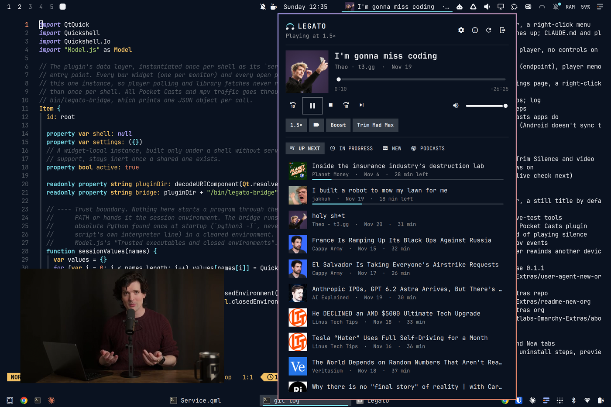

# Legato

A Pocket Casts player in the Omarchy bar that keeps your place across your
phone and your computers. Sign in with your Pocket Casts account, then play
your Up Next, in-progress and new episodes and browse your shows. Pause here,
carry on on your phone, come back: Legato asks Pocket Casts where you are
before it plays again.

In development. Legato is a hard fork of Nine Point Labs'
[Pocket Casts plugin](https://github.com/Ninepointlabs-Omarchy-Extras/omarchy-pocketcasts)
(MIT), with a resume that never rewinds your other devices, no background
polling, and more to come.

Audio plays through `mpv` in the background. There's no browser and no app
window.



| Up Next | In Progress | New releases |
|---|---|---|
|  |  |  |

> **Unofficial API.** Pocket Casts has no public API. This plugin uses the
> same endpoints as the Pocket Casts web player, so it can break whenever
> Pocket Casts changes them. It isn't affiliated with or endorsed by Pocket
> Casts or Automattic.

## Requirements

- `mpv` (required): `omarchy pkg add mpv`
- `mpv-mpris` (optional, for media keys and `playerctl`): `omarchy pkg add mpv-mpris`
- A Pocket Casts **email and password**. If you sign in with Apple or Google,
  set a password on your Pocket Casts account first.

## Install

```sh
omarchy plugin add https://github.com/cwilliams5/omarchy-legato.git --enable
```

The chip appears in the right section of the bar.

To work from a checkout instead:

```sh
git clone https://github.com/cwilliams5/omarchy-legato ~/Projects/omarchy-legato
~/Projects/omarchy-legato/install.sh          # adds the widget to the right of the bar
~/Projects/omarchy-legato/install.sh center   # or pick a section
```

Run `install.sh` again after you pull changes. If the panel doesn't pick
them up, run `omarchy restart shell`.

## Uninstall

Stop playback first (the stop button, or **Sign out**, which also closes the
player), since mpv keeps running on its own. Then:

```sh
omarchy plugin remove io.github.cwilliams5.legato
rm -rf ~/.local/state/omarchy-legato ~/.cache/omarchy-legato   # login tokens, playback state, cover cache
```

`mpv` and `mpv-mpris` are ordinary packages; remove them with
`omarchy pkg remove` if nothing else uses them.

## Using it

Click the bar chip to open the panel. The first time, it asks you to sign in.

| Bar action   | Does                    |
| ------------ | ----------------------- |
| Left click   | Open or close the panel |
| Middle click | Play / pause            |
| Right click  | Skip forward            |
| Scroll       | Volume ±5               |

The panel has tabs for Up Next, In Progress, New releases and Podcasts. It
also has a seek bar, skip back and forward, stop, playback speed (0.8× to 3×),
and Trim Silence (Off, Mild, Medium, Mad Max: the same levels as the Pocket
Casts apps), which cuts the pauses before the speed-up applies, and Volume Boost (`o`),
which makes voices louder the way the Pocket Casts apps do (+10 dB, with a
limiter so it never clips).

**Video:** for an episode with video, a video button (or `v` in the panel)
opens it in a small floating window, pinned on every workspace in the
bottom-right corner, without taking focus; move or resize it and it opens
there next time. Closing it (its ×, or `q` inside it) hides the video and
the episode plays on. Trim Silence pauses while the video shows.

**Settings:** the gear in the panel's header (or `g`) lists every setting
below and saves changes as you make them. **Right-click** an episode for a
menu: play, move to the top or bottom of Up Next (play next or last for
one not queued), remove from Up Next, mark played or unplayed.

**Before sleep:** while an episode is loaded, Legato holds a short logind
sleep delay. When the computer is about to sleep (a closed lid, say) it
pauses the episode and sends your position to Pocket Casts first, so your
phone carries on from the right spot and nothing plays on behind the lock
screen after waking. Turn it off with the `pauseOnSleep` setting.

**Skip intro and outro:** a show's "skip first" and "skip last" times, set
in any Pocket Casts app, apply here too: a new episode starts past the
intro, and an episode ends (marked played, on to the next) where its outro
would begin.
Stopping unloads the episode and shrinks the bar chip back to its icon.

**Sync:** while an episode plays, the plugin sends your position to Pocket
Casts every 30 seconds, and again when you pause, stop or switch episodes.
A finished episode is marked as played. If autoplay is on, the next Up Next
episode starts after that.

**Resources:** the plugin starts no process while paused or idle. While an
episode plays, it runs the bridge once every 30 seconds to send your
position; everything else (pause, resume, seeks, the end of an episode)
arrives as an event from mpv. After `unloadAfterMinutes` paused (15 by
default) the player is closed altogether and the bar chip goes back to its
icon; play picks up from wherever Pocket Casts says you are.

Before a paused episode plays again (from the panel, a media key or
`playerctl`, or when the machine wakes up mid-episode), the plugin asks
Pocket Casts where you are. If you listened on in another device meanwhile,
it picks up from there: later in the same episode, or whatever is now at the
top of Up Next if that device finished this one or started another. A paused
position that hasn't moved is never sent again, so pausing, stopping or
switching episodes here can't rewind your phone.

**About:** the 󰋽 button at the top of the panel (or `i` in the panel, or
`omarchy-shell io.github.cwilliams5.legato about`) shows the version, the
license (readable in place), who made it and what it's based on, what it
does with your data, and a *Report* button that opens a new GitHub issue
with your version details filled in. Back or `Esc` returns to the player.

### Keybindings

The service listens for IPC commands under the `legato` target:

```sh
omarchy-shell io.github.cwilliams5.legato toggle   # open/close the panel
omarchy-shell io.github.cwilliams5.legato about    # open the panel on its About page
omarchy-shell legato playPause
omarchy-shell legato status                 # JSON: playing, title, show, position, speed
```

For example, in `~/.config/hypr/bindings.conf`:

```
bindd = SUPER ALT, P, Legato play/pause, exec, omarchy-shell legato playPause
```

The commands are `playPause`, `next`, `skipBack`, `skipForward`, `stop`,
`volumeUp`, `volumeDown`, `cycleSpeed`, `cycleTrim`, `toggleBoost`, `toggleVideo`,
`refresh` and `status`.

## Settings

| Key             | Default  | Meaning                                                   |
| --------------- | -------- | --------------------------------------------------------- |
| `showTitle`     | `true`   | Show an "Episode · Show" label next to the cover          |
| `scrollTitle`   | `false`  | Scroll a label that doesn't fit; otherwise it's cut off with "…" (scrolling redraws the bar every frame while playing) |
| `maxLabelWidth` | `180`    | Maximum label width in px (60–600)                        |
| `defaultTab`    | `upnext` | Tab the panel opens on: `upnext`, `progress`, `new` or `podcasts` |
| `skipBack`      | `10`     | Seconds to skip back                                      |
| `skipForward`   | `30`     | Seconds to skip forward                                   |
| `autoplay`      | `true`   | Play the next Up Next episode when one finishes           |
| `pauseOnSleep`  | `true`   | Pause and save your place before the computer sleeps      |
| `videoPinned`   | `true`   | Keep the video window on top, on every workspace          |
| `unloadAfterMinutes` | `15` | Unload the player after this many minutes paused; `0` keeps it loaded. An unloaded player isn't reachable by media keys; a loaded, paused one uses no CPU and about 90 MB (more once a video has been shown in it) |

## Privacy and security

- The password goes to Pocket Casts once, at sign-in, over stdin. It's never
  passed as a command-line argument and never stored.
- Only the access and refresh tokens are kept, in
  `$XDG_STATE_HOME/omarchy-legato/auth.json` (mode 0600). Signing out
  deletes them.
- The bridge only connects to Pocket Casts hosts: `api.pocketcasts.com` (the
  only one that gets your token), the episode-list CDN, and
  `static.pocketcasts.com` for artwork. Audio streams from each show's own
  host through mpv.

## Development

```sh
python3 -I -B -m unittest discover -s tests -p 'test_*.py'   # bridge, including a real mpv against a fake server
node --test tests/model.test.cjs                             # Model.js and static QML checks
```

## License

MIT. Copyright (c) 2026 Nine Point Labs and (c) 2026 Cody Williams; see
[LICENSE](LICENSE). Not affiliated with or endorsed by Pocket Casts or
Automattic.
